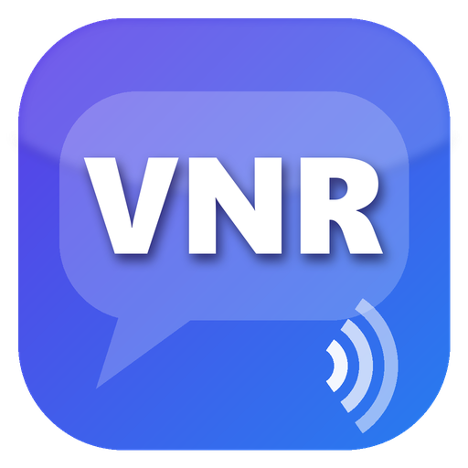
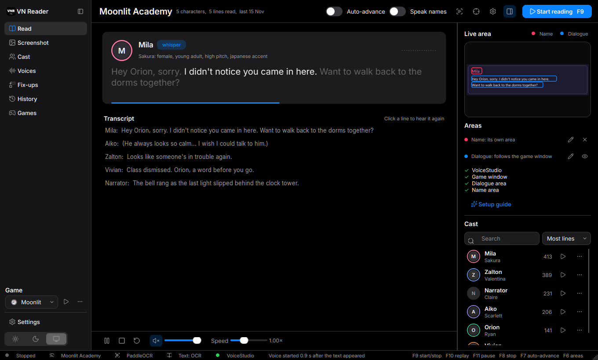
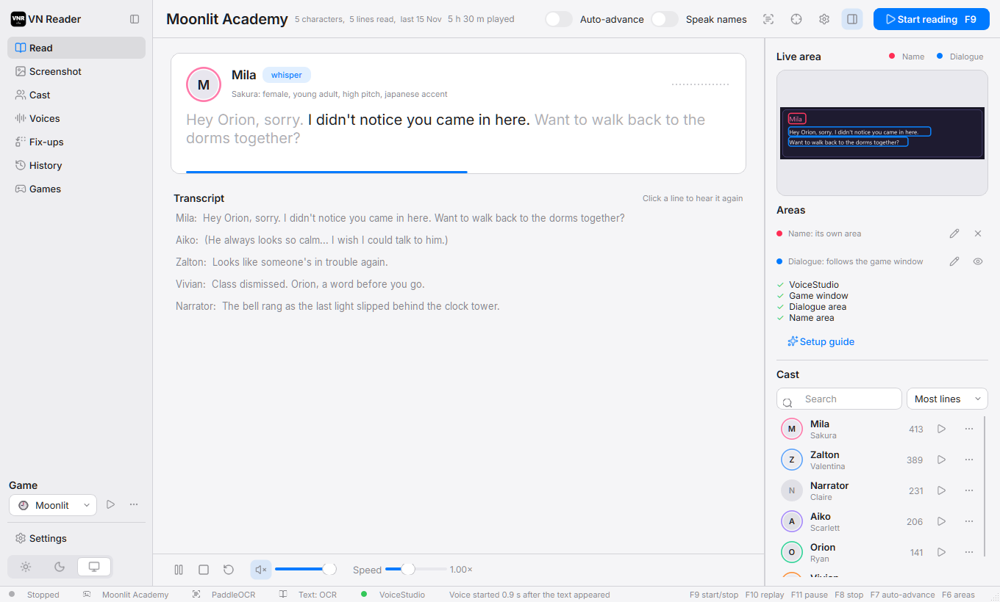
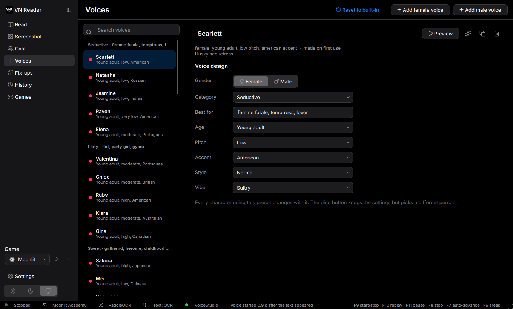
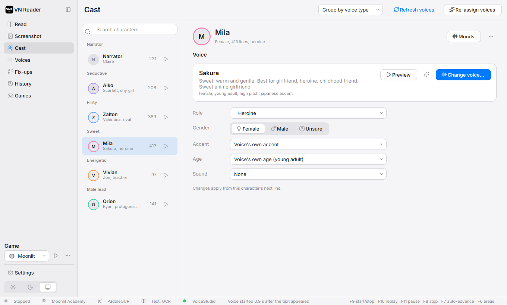
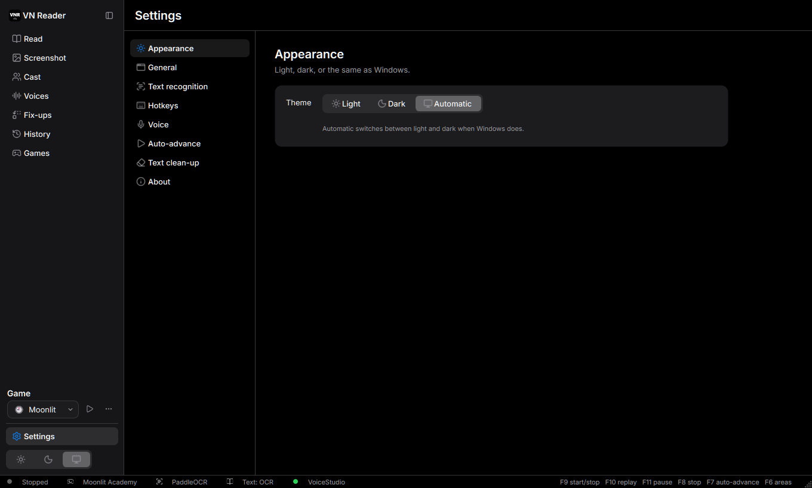
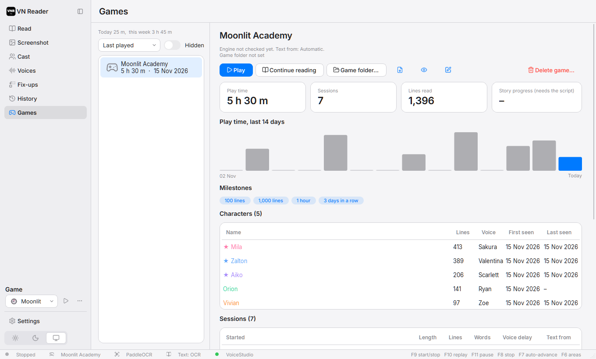
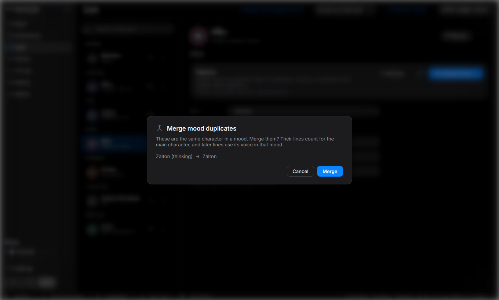
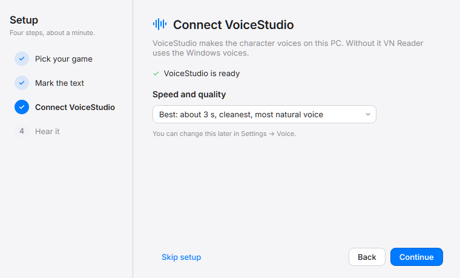
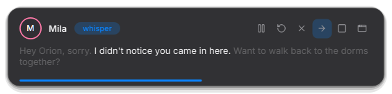

<p align="center">
  
</p>

<h1 align="center">VN Reader</h1>

<p align="center">
  Voices any visual novel. VN Reader reads the dialogue from your screen (or straight from a
  Ren'Py game) and speaks it with a separate local AI voice for every character.
</p>

<p align="center">
  <a href="../../releases"></a>
  
  
  
  
  
</p>

<p align="center">
  
</p>

## Table of contents

- [Features](#features)
- [Screenshots](#screenshots)
- [Tech stack](#tech-stack)
- [Getting started](#getting-started)
  - [Prerequisites](#prerequisites)
  - [Install the .exe](#install-the-exe)
  - [Run from source](#run-from-source)
  - [Set up VoiceStudio](#set-up-voicestudio)
- [Usage](#usage)
  - [First run](#first-run)
  - [Hotkeys](#hotkeys)
  - [Speed and quality](#speed-and-quality)
  - [Speaker tags, moods and effects](#speaker-tags-moods-and-effects)
  - [Ren'Py games: script and hook](#renpy-games-script-and-hook)
  - [Troubleshooting](#troubleshooting)
- [Development](#development)
  - [Project structure](#project-structure)
  - [Run the tests](#run-the-tests)
  - [Build the .exe](#build-the-exe)
- [Roadmap](#roadmap)
- [Contributing](#contributing)
- [License](#license)

## Features

- **A voice per character.** Speaker names are read from the name box; each new character
  gets their own gender-matched voice from 60 built-in presets in 12 groups (seductive,
  sweet, mature, male lead, narrator…). Voices are saved once in VoiceStudio, so a character
  sounds the same on every line.
- **Works with any game.** Screen OCR with PaddleOCR (PP-OCRv6, default) or Windows OCR (any
  language). For Ren'Py games it can read the game's script to fix OCR mistakes, or take
  every line straight from the game through an optional hook.
- **Emotions.** Stage directions (`*whispers*`, `*giggles*`), hearts, `~`, stutters and
  shouting pick a mood; there are seductive, aroused, whisper, happy, sad and angry versions
  of every voice. Directions are never read aloud.
- **Speaker tags understood.** `Zalton (thinking)` or `Mila (whispering)` is Zalton or Mila
  in that mood, not a new character. `(on the phone)` and `(radio)` add a call or radio sound.
  `Younger Zalton` gets Zalton's voice, a step younger.
- **Fast.** The next script line is made while the current one plays (Ren'Py hook), the
  first sentence is made at a quicker quality, and you choose speed vs. quality: about 1 s,
  1.5 s or 3 s.
- **Hands-free.** Auto-advance moves the game on after each line. The play timer, session
  stats and per-game history live on the Games page.
- **Light and dark.** An Apple-style interface with Light, Dark and Automatic (follows
  Windows) themes, a setup guide, a floating bubble or mini-player over the game, and global
  hotkeys.
- **Local.** OCR and voices run on your PC. Nothing is sent to the internet.

## Screenshots

| Light | Dark |
|---|---|
|  |  |
|  |  |
|  |  |

<p align="center">
  
  <br><sub>Setup guide (first launch)</sub>
</p>

<p align="center">
  
  <br><sub>Mini-player: the speaker, the mood, the sentence being spoken and the progress</sub>
</p>

> The screenshots use a made-up game and cast.

## Tech stack

| Area | Used |
|---|---|
| Language | Python 3.11–3.13 |
| UI | [PySide6](https://doc.qt.io/qtforpython/) (Qt 6), [Lucide](https://lucide.dev/) icons, [Inter](https://rsms.me/inter/) font |
| Voices | [VoiceStudio](https://github.com/debpalash/voicestudio) (local, OmniVoice) over its HTTP API; Windows SAPI as a fallback |
| OCR | PaddleOCR PP-OCRv6 models via [RapidOCR](https://github.com/RapidAI/RapidOCR) + ONNX Runtime (DirectML); Windows.Media.Ocr via [winocr](https://pypi.org/project/winocr/) |
| Capture & audio | [mss](https://pypi.org/project/mss/), Win32 / DWM via `ctypes`, [sounddevice](https://pypi.org/project/sounddevice/), [soundfile](https://pypi.org/project/soundfile/), NumPy |
| Text | [pyspellchecker](https://pypi.org/project/pyspellchecker/), [gender-guesser](https://pypi.org/project/gender-guesser/) |
| Packaging & tests | [PyInstaller](https://pyinstaller.org/), [pytest](https://pytest.org/) |

## Getting started

### Prerequisites

| | Needed | Notes |
|---|---|---|
| Windows 10 or 11 (64-bit) | Required | Window capture, DWM and Windows OCR are Windows-only. |
| [VoiceStudio](https://github.com/debpalash/voicestudio) | Strongly recommended | Makes the natural voices. Without it, Windows voices are used. |
| NVIDIA GPU | Recommended | VoiceStudio also runs on the CPU, much slower. |
| Python 3.11–3.13 | Only to run from source | Not needed for the .exe. |

### Install the .exe

1. Download **`VN.Reader.exe`** from the [Releases](../../releases) page.
2. Put it in any folder and run it. There is no installer.
   Windows SmartScreen may warn about an unsigned exe: **More info → Run anyway**.

Settings are stored in `%APPDATA%\VNReader\settings.json`, so you can replace the exe
without losing anything.

### Run from source

```bash
git clone https://github.com/mdsamiulhaq03/VNR.git
cd VNR
```

Double-click **`VN Reader.bat`**: the first run creates `.venv` and installs
`requirements.txt`. Or by hand:

```bash
py -3.13 -m venv .venv
.venv\Scripts\python -m pip install -r requirements.txt
.venv\Scripts\python main.py
```

No environment variables are needed. Optional ones (used by the tests):

| Variable | Effect |
|---|---|
| `VNR_HOOK_PORT` | Port for the Ren'Py hook listener (`0` = any free port) |
| `VNR_NO_AUTOSTART` | Never start VoiceStudio automatically |
| `VNR_NO_SETUP_GUIDE` | Don't open the setup guide on first launch |

### Set up VoiceStudio

1. Install it from <https://github.com/debpalash/voicestudio>, for example in PowerShell:
   ```powershell
   irm https://voicestudio.sh/install.ps1 | iex
   ```
2. Start it once and let it download its voice model.

VN Reader connects to `http://127.0.0.1:3900` and **starts VoiceStudio by itself** when it
isn't running (when VN Reader opens and when you start reading). Turn that off, or set a
different program path or address, in **Settings → Voice**. The status light at the bottom of
the window shows ready / making a voice / starting / offline; click it for options.

You don't need to create voices in VoiceStudio: VN Reader saves its own as `VNR - <name>`.

## Usage

### First run

The **setup guide** opens on first launch (also from **Setup guide** on the Read page):

1. **Pick your game**: choose the game's window (or its folder).
2. **Mark the text**: with a line on screen, press **F6**, drag a box around the speaker's
   name (Enter skips it), then one around the dialogue. Or let **Find them for me** detect both.
3. **Connect VoiceStudio** and choose speed vs. quality.
4. **Hear it**: play a test line, then **Start reading** (**F9**).

New characters appear on the **Cast** page with their own voice. The first line of a new
voice takes 10–20 s while it's made; after that a line starts in about 1–3 s depending on
the speed setting.

### Hotkeys

Global (they work while the game has focus; change them in **Settings → Hotkeys**):

| Key | Action |
|---|---|
| `F9` | Start / stop reading |
| `F10` | Replay the last line |
| `F11` | Pause / resume (also pauses the play timer) |
| `F8` | Stop speaking |
| `F7` | Auto-advance on / off |
| `F6` | Mark the name area, then the dialogue area |

In VN Reader's window:

| Key | Action |
|---|---|
| `Ctrl+1` … `Ctrl+7`, `Ctrl+,` | Read, Screenshot, Cast, Voices, Fix-ups, History, Games, Settings |
| `Ctrl+Enter` | Start / stop reading |
| `Ctrl+B` / `Ctrl+I` | Sidebar / inspector |
| `Ctrl+Shift+S` | Game setup |
| `F1` | All shortcuts |

### Speed and quality

**Settings → Voice → Speed / quality** (time until the voice starts, measured on an
RTX 3060 Ti for one sentence):

| Option | Delay | Quality |
|---|---|---|
| Instant | ~1 s | Rougher, may crackle a little |
| Balanced | ~1.5 s | Good |
| Best (default) | ~3 s | Cleanest; **Quick start** makes the first sentence ~1.7 s |

### Speaker tags, moods and effects

| The game shows | VN Reader does |
|---|---|
| `Zalton (thinking)` | Zalton's voice, as a thought |
| `Mila [whispering]` | Mila's whisper voice |
| `Ann (on the phone)` / `Ops (radio)` | That character, with a phone or radio sound |
| `Younger Zalton`, `Zalton (young)` | Zalton's voice a step younger and higher (ages stay adult) |
| `Bro (Mark)` | Unknown tag: kept as its own character |
| `*Seductively* And this might be fun.` | Read slower in the seductive voice; the direction isn't spoken |

Old `Name (tag)` characters from earlier versions can be folded in with **Cast → Merge mood
duplicates**. A character can also always sound like a call or radio: **Cast → Sound**.

### Ren'Py games: script and hook

Game menu (**⋯** next to the game) → **Game folder (read its script)…**:

- VN Reader reads the `.rpy` scripts (also inside `.rpa` archives) and corrects OCR reads and
  names from them.
- It offers the **game hook**: one file, `game/zz_vnreader_hook.rpy`, that sends each line to
  VN Reader on this PC the moment it appears (exact text, no OCR). Restart the game after
  installing or removing it. With the hook, the next line is prepared while the current one
  plays.

### Troubleshooting

| Problem | Fix |
|---|---|
| Nothing is read | Check the Areas checklist on the Read page; press the eye button to see the areas, and **Settings → Text recognition → Test OCR**. |
| Area is black or wrong in full screen | Use windowed or borderless mode. |
| Lines go to the wrong character | Give the name its own area (F6, then drag the name box). |
| A misread name made a duplicate | **⋯ → Merge into** on the duplicate. |
| "VoiceStudio offline" | Click the status light → **Start VoiceStudio**, and wait for its model to load. |
| Lines start slowly | Pick **Instant** or **Balanced**, keep **Quick start** on, and set the game's text speed to instant. Per-line timings: `%APPDATA%\VNReader\latency.log`. |
| A word is pronounced wrong | Add a rule on the **Fix-ups** page. |

## Development

### Project structure

```text
main.py                    entry point (main.py --selftest out.txt checks OCR, fonts, voices)
app/
  config.py                settings, per-game characters, merges, tagged-name folding
  emotion.py               stage directions and speaker tags -> mood, sounds, effects
  voices.py                gender guessing, presets -> voice designs, "Younger X" voices
  voice_bank.py            one cloned VoiceStudio voice per design (+ mood variants)
  speech_queue.py          sentence-by-sentence synthesis, prefetch, effects, sentence tags
  vs_launcher.py           starts VoiceStudio when it isn't running
  playtime.py              play clock, sessions, per-game history
  audio/                   player (gapless, sentence tracking), phone / radio effects
  tts/                     VoiceStudio client (one request at a time, 429 retry), SAPI
  sources/                 screen capture, OCR engines, filters, Ren'Py hook listener
  game_scripts/            Ren'Py script parsing, .rpa archives, the game hook
  ui/                      PySide6 interface
    theme.py               light / dark tokens, stylesheet, theme-following icons
    components.py          buttons, sheets (dialogs), avatars, banners
    main_window.py         the window and the Read page
    setup_wizard.py        first-launch guide
    mini_player.py         floating mini-player
assets/                    icons (Lucide), fonts (Inter), app icon
docs/screenshots/          README images
tests/                     pytest suite
tools/                     voice checks, icon generation
```

### Run the tests

```bash
.venv\Scripts\python -m pip install -r requirements-dev.txt
.venv\Scripts\python -m pytest -q
```

The suite opens real (invisible) windows and needs Windows. It never starts VoiceStudio or
the setup guide (`tests/conftest.py` sets the variables above).

### Build the .exe

```bash
build_exe.bat
```

This builds `dist\VN Reader.exe` with PyInstaller (`vn_reader.spec`). Check it with:

```bash
"dist\VN Reader.exe" --selftest result.txt
```

## Roadmap

- [ ] Prepare every character's voice in advance from the Ren'Py script
- [ ] Per-character volume and speed
- [ ] Skip or speed up lines already heard (second playthrough)
- [ ] Read choice menus aloud
- [ ] Export a session as an audiobook (MP3 with chapters)
- [ ] Share a game's cast (voices) as a file
- [ ] Translation mode (read a Japanese VN, speak English)
- [ ] Translucent (Mica) sidebar on Windows 11

## Contributing

1. Fork the repo and create a branch: `git checkout -b feature/my-change`.
2. Make the change with tests (`tests/`), and run `pytest -q`.
3. Keep UI colours in `app/ui/theme.py` (no hard-coded colours in widgets; a test checks
   this) and check both themes.
4. Open a pull request describing what changed and why.

Bug reports are welcome as issues: include your Windows version, the game engine,
and `%APPDATA%\VNReader\latency.log` if it's about speed.

## License

No license file yet. Until one is added, all rights are reserved by the author. Add a
`LICENSE` file (for example MIT) to make the terms clear.

Third-party parts keep their own licenses: Inter (SIL OFL 1.1), Lucide icons (ISC),
PaddleOCR models via RapidOCR (Apache 2.0), ONNX Runtime (MIT), Qt for Python (LGPL v3).
VoiceStudio is a separate application (AGPL-3.0); VN Reader only talks to its local API and
includes none of its code.
