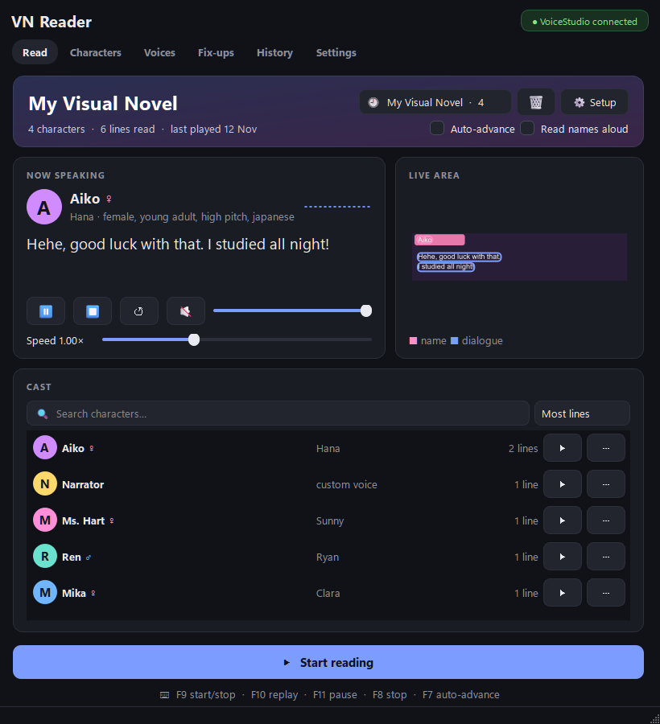
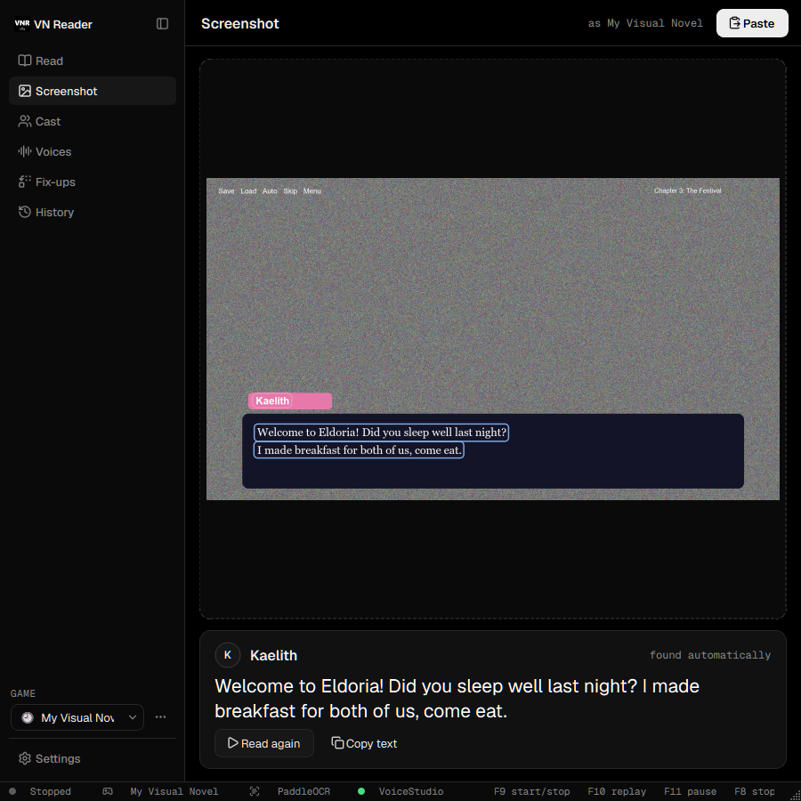
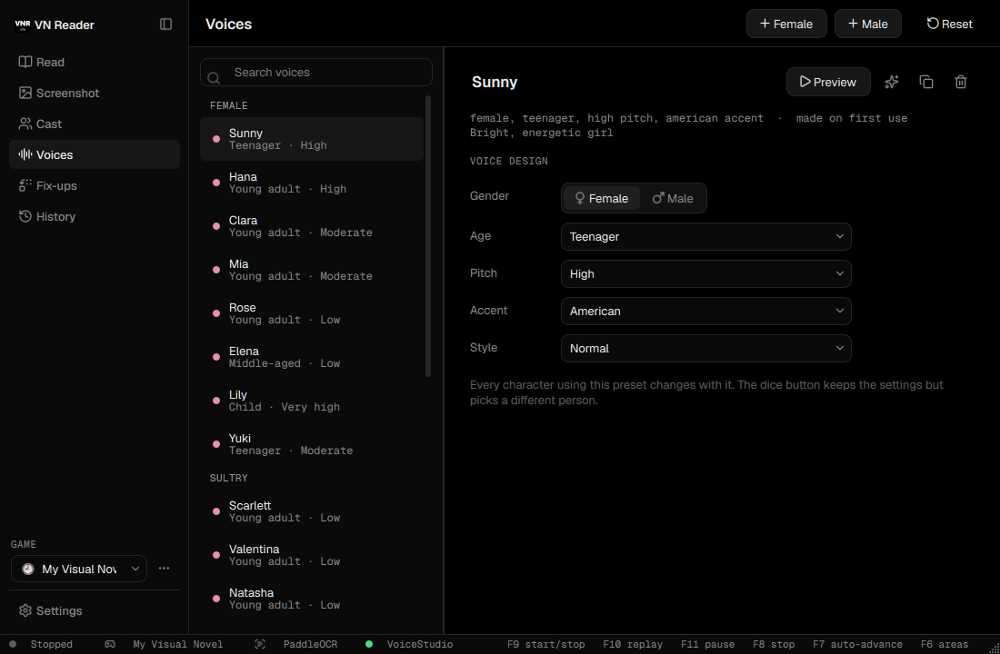
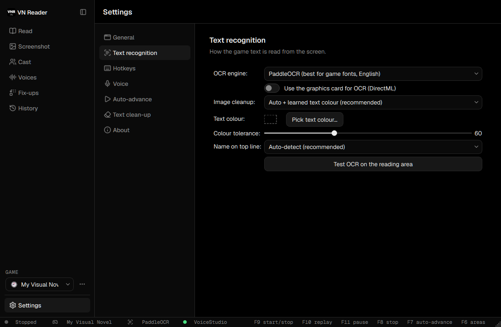

<p align="center">
  
</p>

<h1 align="center">VNR: VN Reader</h1>

<p align="center">
  <b>Turns any visual novel into a fully voiced one.</b><br>
  It reads the dialogue off your screen and speaks it with a different, natural AI voice
  for every character: male voices for male characters, female voices for female ones.
</p>

<p align="center">
  
</p>

---

## Contents
- [What it does](#what-it-does)
- [Requirements](#requirements)
- [Installation](#installation)
  - [Option A: download the ready-made .exe](#option-a-download-the-ready-made-exe-easiest)
  - [Option B: run from source](#option-b-run-from-source)
  - [Set up VoiceStudio (natural voices)](#set-up-voicestudio-natural-voices)
- [First start, step by step](#first-start-step-by-step)
- [Using the app](#using-the-app)
- [Hotkeys](#hotkeys)
- [Settings reference](#settings-reference)
- [Tips & troubleshooting](#tips--troubleshooting)
- [FAQ](#faq)
- [For developers](#for-developers)

---

## What it does

| | |
|---|---|
| 🖥️ **Works with any visual novel** | Ren'Py, KiriKiri, Unity, anything. It reads the text from the screen (OCR), so it never touches the game's files. |
| 🗣️ **A voice per character** | Character names are read from the top line of the dialogue box. Each new character automatically gets their own voice, matched to their gender. |
| 🎙️ **19 ready-made voice presets** | 15 seductive female voices and 4 male, all adults and all editable: age, pitch, accent, style, vibe. Add your own as well. |
| 💋 **Emotions** | `*Seductively*`, `*moans*`, `*giggles*`, ♥ and `~` are acted out (seductive, aroused, whisper, happy, sad, angry versions of each voice) and never read aloud. |
| 🔍 **Two OCR engines** | **PaddleOCR** (default, PP-OCRv6: reads outlined, rounded and coloured game fonts) or the built-in **Windows OCR** (every language). Optional GPU acceleration. |
| 🖼️ **Screenshot page** | Drop or paste a screenshot: the name and dialogue are found by themselves and read aloud. |
| 🧠 **Learns each game** | Its text colour (to filter busy backgrounds) and its made-up words (never auto-corrected). |
| 🔒 **Voices that never drift** | Each voice is made once, checked for quality, and saved in VoiceStudio, so a character sounds the same on every line. |
| 😆 **Emotions** | Laughs, sighs and surprise ("Ahaha", "*sigh*", "Eh?!") are performed, not read out as words. |
| 🔞 **Made for adult VNs too** | Moans, drawn-out sounds, stutters, honorifics and explicit words are read exactly as written, never "corrected" or dropped. |
| ⏭️ **Auto-advance** | After a line has been read, the app moves the game on to the next one, so you can listen hands-free like an audiobook. |
| 🧹 **Clean text** | Skips menu buttons (Back / Skip / Auto / Save…), drops garbled OCR junk, and fixes common misreads. |
| 🕘 **Remembers every game** | Pick a game you've played before and its window, reading area, characters and voices all come back. |
| ⌨️ **Global hotkeys** | Start, pause, replay, auto-advance and **F6 to pick both areas** from inside the game. |
| 🧭 **System tray** | Keeps running in the tray when you close the window; start, pause and pick areas from the tray menu. |
| 💾 **Runs locally** | Text recognition (PaddleOCR or Windows OCR) and voices (VoiceStudio) all run on your own PC. Nothing is sent to the internet. |

---

## Requirements

| | Needed? | Notes |
|---|---|---|
| **Windows 10 or 11** (64-bit) | ✅ required | It uses Windows window capture, and Windows' text recognition for non-English games. |
| **[VoiceStudio](https://github.com/debpalash/voicestudio)** | ⭐ strongly recommended | The free, local AI voice app that makes the natural per-character voices. Without it, VN Reader falls back to the robotic built-in Windows voices. |
| **NVIDIA GPU** | 👍 recommended | VoiceStudio also runs on the CPU, but much slower. On an RTX 3060 Ti a line takes about 1–2 s. |
| **Python 3.11–3.13** | only for Option B | Not needed for the .exe. |

---

## Installation

### Option A: download the ready-made .exe (easiest)

1. Go to the **[Releases](../../releases)** page and download **`VN.Reader.exe`** from the latest release.
2. Put it anywhere you like, e.g. `C:\Games\VN Reader\`.
3. Double-click it. That's it: no installer, no Python.
   > Windows SmartScreen may warn you because the exe isn't code-signed. Click **More info → Run anyway**.

Your settings are saved in `%APPDATA%\VNReader\settings.json`, so you can move or replace the exe without losing anything.

### Option B: run from source

1. Install **Python 3.13** from [python.org](https://www.python.org/downloads/). During setup, tick **"Add Python to PATH"**.
2. Download this repository: **Code → Download ZIP** and extract it, or:
   ```bash
   git clone https://github.com/mdsamiulhaq03/VNR.git
   cd VNR
   ```
3. Double-click **`VN Reader.bat`**.
   The first run creates a virtual environment (`.venv`) and installs everything from `requirements.txt` automatically. That takes a few minutes; after that it starts straight away.

<details>
<summary>Manual setup (if you prefer the command line)</summary>

```bash
py -3.13 -m venv .venv
.venv\Scripts\python -m pip install -r requirements.txt
.venv\Scripts\python main.py
```
</details>

### Set up VoiceStudio (natural voices)

1. Install VoiceStudio from **https://github.com/debpalash/voicestudio**. In PowerShell:
   ```powershell
   irm https://voicestudio.sh/install.ps1 | iex
   ```
   or download the Windows installer from its releases page.
2. Start VoiceStudio and let it download its voice model the first time.
3. Keep VoiceStudio running while you play.

VN Reader finds it automatically at `http://127.0.0.1:3900`. The top-right badge turns green: **● VoiceStudio connected**. If you run it on another PC or port, change the address in **Settings → Voices**.

> You don't need to create any voices in VoiceStudio yourself. VN Reader makes them for you and saves them in your VoiceStudio library as `VNR - <voice name>`.

---

## First start, step by step

1. **Start your visual novel**, preferably in **windowed** or **borderless** mode (see [tips](#tips--troubleshooting)).
2. **Start VoiceStudio** and then **VN Reader**.
3. **Fastest way: press F6 while the game shows a line with a name.**
   - **Step 1 of 2:** drag a box around the speaker's **name**. If the game has no separate name box, press **Enter** to skip.
   - **Step 2 of 2:** drag a box around the **dialogue** text.

   That's it: the game window is detected by itself, and the areas follow it when you move or resize the window. **Esc** cancels and changes nothing; **right-click** redraws the current box.

   Or do it by hand: open **Game setup** (the gear button in the Read toolbar, or **Ctrl+Shift+S**):
   1. **Window**: pick your game from the list. The reading area then follows the game window, even if you move or resize it.
   2. **Profile**: the name your characters and voices are saved under. It's filled in from the game automatically.
   3. Draw the two areas (each has its own row in Setup):
      - **Name area**: a box around where the speaker's name appears.
      - **Dialogue area**: a box around the dialogue text.

      The name area is optional: without it, draw the dialogue area around the whole dialogue box *including* the name line, and the name is taken from the top line. With it, the name can never be mixed up (see [Name area](#separate-name-area-optional)).
4. Click **▶ Start reading** (or press **F9**).
5. Play. Every new line is read aloud as soon as it has finished appearing. Clicking ahead in the game cuts off the current line.

New characters appear in the **Cast** list automatically, each with their own voice. The very first line of a new voice takes about 10–20 seconds extra while VoiceStudio prepares it. After that, the voice starts about 1.5 seconds after the text appears.

### Separate name area (optional)

By default the app finds the speaker's name on the **top line** of the reading area. That works for most games, but sometimes a short first line of dialogue ("Good Morning") looks like a name, or a name is missed, and the line gets the wrong voice.

For those games, give the name its own box:

1. Press **F6** in the game (or **Game setup → Pick both from the game**) and drag the **name** box, then the **dialogue** box. Make the name box a little wider than the longest name.
2. Or draw them one at a time with the ✏ buttons in the **Areas** section of the Read page's inspector.

From then on the name is read **only** from the name area, and everything in the reading area is dialogue. An empty name area means the narrator. The **eye** button outlines both boxes on screen (the name area in pink), and the **Live area** shows the name strip above the dialogue. Click **✕** on the name row to go back to one area.

> With **Windows OCR**, very short names (two letters, like "Ai") and "???" can be missed; those lines then go to the narrator. **PaddleOCR** reads them.

Even without a name area, a top line that's **ALL CAPS** ("LUNA") or a **different colour** from the dialogue (blue name over white text) is recognised as the name.

---

## Using the app

### The window

The app is laid out like a desktop tool: a **sidebar** on the left (Read, Screenshot, Cast, Voices, Fix-ups, History, Settings; **Ctrl+1…6**, **Ctrl+,**), a **toolbar** at the top of each page, and a **status bar** at the bottom showing whether it's reading, the game, the OCR engine and VoiceStudio. The **game switcher** sits at the bottom of the sidebar (its **⋯** menu has Game setup, Pick areas and Delete game). **Ctrl+B** collapses the sidebar to icons; it also collapses by itself when the window is narrow.

### Read page

| Part | What it does |
|---|---|
| **Toolbar** | **Start / Stop reading** (F9 or Ctrl+Enter), the **Auto-advance** (F7) and **Speak names** switches, **Pick areas** (F6), **Game setup** and the inspector toggle (Ctrl+I). |
| **Now speaking** | Who's talking (a pink/blue dot shows the gender), which voice they use, a level meter, and the line in large text. |
| **Transcript** | The last lines you heard, newest first. **Click one to hear it again.** |
| **Transport** (bottom) | Pause, stop, replay, mute, volume and speed. |
| **Inspector** (right, resizable) | **Live area**: what the app is reading, with the **name outlined in pink** and the **dialogue in blue**. **Areas**: the name and dialogue areas, with buttons to draw, remove and show them, and a short checklist of what's ready. **Cast**: every character in this game; search, sort, ▶ preview, and **⋯** to edit, rename, merge or delete. |

> **Who is speaking?** If the dialogue box has a name on its top line, that character speaks. **No name means the narrator**, and the narrator reads the whole text.

### Screenshot page


Read a screenshot instead of the live game: **drop an image** onto the tab, or take a screenshot (**Win+Shift+S** or **PrtScn**) and press **Ctrl+V** there. It's read aloud by itself, with the right character's voice.

- **The name and dialogue are found automatically** in the whole screenshot: menu buttons and other UI text are ignored, and the name box above the dialogue is recognised. They're outlined in the preview (name pink, dialogue blue).
- If you've set this game's areas (F6) and the screenshot has the same shape as the game window, those areas are used: the most accurate way.
- Drop several images at once and they're read one after another. **▶ Read again** and **Copy text** are below the preview.
- Lines go to this game's characters and History, just like live reading. Auto-advance is never triggered by screenshots.

<br clear="right">

### Cast page


The list on the left shows every character (search at the top); the editor on the right edits the selected one:
- **♀ / ♂ / ?**: the gender is guessed from the name (English and Japanese names, plus titles like *Mr.*, *Ms.*, *Onee-chan*, *-kun*). If a guess is wrong, click to fix it and the character gets a voice of the right gender.
- **Voice**: any **preset**, a **custom voice** (choose pitch and style yourself), one of **your own VoiceStudio voices**, or a **Windows voice**.
- **Accent**: change this character's accent only.
- **Age**: make this character sound younger or older (young adult, middle-aged or elderly), with any preset or custom voice. VoiceStudio makes the new voice on the next line (a few seconds, once).
- **✨** (sparkles): switch to the next free preset. **Preview**: hear the voice.
- **⋯**: **rename**, merge or delete.

**Renaming:** **⋯ → Rename…** changes how a character is shown (e.g. "PRESENTER" → "Presenter"). The voice stays the same, and when the game shows the old name again, the line still goes to the renamed character.

**Merging duplicates:** when the text reader misreads a name (for example "Sayorl" instead of "Sayori"), a second character appears. Use **⋯ → Merge into → Sayori**. The lines are combined, and the misspelling is remembered so it never comes back.

<br clear="right">

### Voices page (presets)


The 19 built-in voices (all adults). Each has a **vibe**: the mood its voice is recorded in, which sets how it talks every day.

| ♀ Female | | | |
|---|---|---|---|
| **Scarlett** | husky seductress, American · *sultry* | **Mei** | soft and alluring, Chinese · *sweet* |
| **Natasha** | cool femme fatale, Russian · *sultry* | **Seo-yeon** | cute idol type, Korean · *sweet* |
| **Valentina** | warm Latina tease, Portuguese · *flirty* | **Kiara** | sun-kissed flirt, Australian · *flirty* |
| **Chloe** | teasing British flirt · *flirty* | **Bella** | girl next door, American · *sweet* |
| **Ruby** | bubbly and flirty, American · *flirty* | **Raven** | dark husky whisper · *breathy* |
| **Sakura** | sweet anime girlfriend, Japanese · *sweet* | **Vivian** | elegant mature temptress, British · *dominant* |
| **Yumi** | breathy whisper, Japanese · *breathy* | **Lena** | confident and commanding · *dominant* |
| **Jasmine** | smooth and sensual, Indian · *sultry* | | |

| ♂ Male | | | |
|---|---|---|---|
| **Ryan** | protagonist / friend, American | **Kenji** | gentle male lead, Japanese |
| **Damien** | smooth and seductive, British · *charming* | **Marcus** | deep and commanding · *dominant* |

Presets are grouped **Seductive / Sweet & flirty / Mature & dominant / Male** on the left. Change any preset's **name, gender, age, pitch, accent, style** (Normal or Whisper) and **vibe** on the right. **✨** gives a different person with the same settings, the copy button duplicates a preset, **+ Female / + Male** in the toolbar add a new one, and **Reset** restores the built-in set.

New characters automatically get an **unused preset of their gender**, so the first 15 female characters all sound different. After that, extra characters get a custom voice with its own pitch, accent and vibe.

#### Emotions
Stage directions are **never read aloud**. The mood they describe is performed instead:

| The game shows | You hear |
|---|---|
| `*Seductively* And this might be fun.` | "And this might be fun…", slower, in the voice's **seductive** version |
| `*moans softly* Don't stop.` | "Mmmh… Don't stop…", breathy (**aroused**) |
| `Hi! *giggles* You're cute.` | a real laugh in place of *giggles* |
| `*kisses you*` | "Mwah." |
| `Hey there~ ♥` | flirty; the `~` and heart aren't spoken |
| `(She's so beautiful…)` | an inner thought, whispered |
| `WHAT ARE YOU DOING?!` | angry (not spelled out) |

Around 25 moods are recognised (seductive, aroused, begging, dominant, tender, shy, scared, playful, happy, sad, jealous, cold, angry, drunk, sleepy, …), from adverbs like *Teasingly* or *Nervously* and actions like *bites her lip* or *blushes*. Hearts, a trailing `~`, moans, stutters ("I-I…") and SHOUTING are read as cues too. Each voice gets up to six **emotional versions** (seductive, aroused, whisper, happy, sad, angry). They're made from the same voice, so it still sounds like her, in the background the first time a mood comes up (about 2–3 s each). The current mood is shown next to the voice on the Read page.

<br clear="right">

### Fix-ups page
Your own word replacements, applied before a line is spoken. Use them for names the voice pronounces wrong (`Saeko` → `Sah-eh-ko`) or recurring OCR mistakes. You can make a rule for **this game** or **all games**. Rules also apply to character names.

**Game words** (below the rules): names, places and made-up words of this game that the spell-fixer must never "correct". Words that appear in **3 different lines** are learned automatically (shown dimmed); add your own, or remove one (a removed word isn't learned again).

### History page
Every line read this session in a table (time, speaker, line), with **search** in the toolbar. **Double-click** a line to hear it again; the toolbar can play, copy, export to a text file, or clear.

### Settings


Sections on the left: **General** (window & tray), **Text recognition**, **Hotkeys**, **Voice**, **Auto-advance**, **Text clean-up** and **About** (versions and open-source licenses).

See the [settings reference](#settings-reference) below for every option.

<br clear="right">

---

## Hotkeys

These work **while you're in the game**. You can change them in Settings.

| Key | Action |
|---|---|
| **F9** | Start / stop reading |
| **F10** | Replay the last line |
| **F11** | Pause / resume |
| **F8** | Stop speaking |
| **F7** | Auto-advance on / off |
| **F6** | Pick the name area, then the dialogue area (straight from the game) |

Inside the app window:

| Keys | Action |
|---|---|
| **Ctrl+1 … Ctrl+6**, **Ctrl+,** | Read, Screenshot, Cast, Voices, Fix-ups, History, Settings |
| **Ctrl+Enter** | Start / stop reading |
| **Ctrl+B** / **Ctrl+I** | Collapse the sidebar / show or hide the inspector |
| **Ctrl+Shift+S** | Game setup |
| **Ctrl+V** (Screenshot page) | Read the screenshot on the clipboard |

---

## Settings reference

<details open>
<summary><b>Text recognition</b></summary>

| Setting | What it does |
|---|---|
| **OCR engine** | *PaddleOCR* (default, PP-OCRv6): reads outlined, rounded and coloured game fonts much better, and is fast (~0.06 s per line). English only. *Windows OCR*: built into Windows, every language. Non-English games use Windows OCR automatically. |
| **Use the graphics card for OCR** | Runs PaddleOCR on your GPU (DirectML, no extra install). About 3.5× faster for whole screenshots, but a little slower for small dialogue boxes, so it's off by default for live reading. The Screenshot tab always uses the GPU when it can. |
| **Image cleanup** | *Auto + learned text colour* (recommended): after a few lines, the app learns the colour of this game's dialogue text (the swatch shows "(learned)") and uses it to read lines on busy, animated or see-through backgrounds. *Auto* cleans up without learning. *Text colour only* uses a colour you pick. *Off* reads the raw image. |
| **Pick text colour…** | Click a letter of the dialogue to choose its colour (for *Text colour only*). **Colour tolerance** sets how strict that colour match is. |
| **Name on top line** | *Auto-detect* (recommended), *Always* (the top line is always a name) or *Never* (this game has no names). |
| **Test OCR on the reading area** | Shows exactly what the app sees: the cleaned-up image, the name, the text, what was skipped and why, and what was fixed. |
</details>

<details open>
<summary><b>Voices</b></summary>

| Setting | What it does |
|---|---|
| **VoiceStudio address / API key** | Normally `http://127.0.0.1:3900` with no key. You only need a key for a VoiceStudio on another PC. |
| **Read lines with no speaker name** | Read narration (on) or skip it (off). |
| **Speak character names** | Say "Luna." before Luna's line. Off by default: only the dialogue is spoken. Also in the dashboard header. |
| **Act out emotions** | Perform `*stage directions*`, hearts, laughs, sighs and surprise. Directions are never read aloud, even with this off. |
| **Emotional voice variants** | Seductive / aroused / whisper / happy / sad / angry version of each voice, made in the background on first use. |
| **Voice action sounds** | `*moans*`, `*kisses*`, `*pants*`… become "Mmmh…", "Mwah.", "Haah… haah…" instead of silence. |
| **Voice quality** | *Fast* (starts talking quickest), *Balanced* (recommended), *Best* (slowest). |
| **Quick start** | On by default. Each line's first sentence is made on *Fast* quality so the voice starts about 1 s sooner; the rest of the line uses the quality above. Same voice either way. |
| **Save each character's voice** | Keeps every voice identical on every line. Leave it on: without it, VoiceStudio re-invents the voice for every sentence. |
| **Accent for all voices** | One accent for everyone (e.g. British), or keep each voice's own. |
</details>

<details open>
<summary><b>Auto-advance</b></summary>

| Setting | What it does |
|---|---|
| **Next line by** | *Press Enter* works in most games (Ren'Py included). Use *Click the dialogue box* if your game ignores keys. *Space* and *Ctrl* are also available. |
| **Pause after each line** | How long to wait after the voice finishes (0–4 s). |

Auto-advance stops by itself at choice menus, because the text stops changing.
</details>

<details open>
<summary><b>Text clean-up</b></summary>

| Setting | What it does |
|---|---|
| **Ignore menu words** | Lines made of these words are treated as menu buttons and skipped. Defaults: Back, History, Skip, Auto, Save, Load, Q.Save, Q.Load, Prefs, Settings, Menu… |
| **Fix common OCR mistakes** | English only: `rn`→`m`, `\|`→`I`, `Tbe`→`The`. Character names, interjections and adult vocabulary are never changed. |
</details>

<details>
<summary><b>Hotkeys & everything else</b></summary>

Change or clear any hotkey.

**Window & tray** (top of Settings):
- **Show VN Reader in the system tray**: the tray icon next to the clock, with Start/Stop, Pause, Auto-advance, Pick areas and Quit. Turn it off if you don't want a tray icon.
- **Keep running in the tray when the window is closed or minimized**: reading and hotkeys keep working in the background; right-click the tray icon to **Quit**. Off: closing the window quits VN Reader.

 Everything is saved automatically in `%APPDATA%\VNReader\settings.json`.
</details>

---

## Tips & troubleshooting

| Problem | Fix |
|---|---|
| **Nothing is read** | Check the **Areas** checklist in the Read page's inspector: is the dialogue area drawn (F6)? Click the **eye** button to see where the areas are, and **Settings → Text recognition → Test OCR** to see what's being read. |
| **The game is full-screen and the area is wrong / black** | Use **windowed** or **borderless window** mode. True exclusive full-screen can block screen capture. |
| **It stops reading when another window covers the game** | Tick **Setup → Keep reading when the game is covered**. Some games block this; the app tells you if yours does. |
| **Garbage or menu words get read** | Draw the area tightly around the text box only. Add the extra words to **Settings → Ignore menu words**. |
| **Lines with animated or see-through backgrounds aren't read** | Set **Image cleanup → Text colour only**, then click **Pick text colour…** and click on a letter. |
| **A name is read as part of the dialogue (or vice versa)** | Set **Settings → Name on top line** to *Always* or *Never* for that game. |
| **Words are misread ("I'm" read as "rm" or "11 am", "@" instead of "a")** | Use **OCR engine → PaddleOCR**. Common misreads are also repaired automatically, including glued words ("reallythought") and missing spaces after commas. |
| **A made-up word or name gets "corrected"** | Add it under **Fix-ups → Game words** (it's also learned by itself after 3 lines). |
| **Lines are given to the wrong character** | Draw a [separate name area](#separate-name-area-optional) so the name is read from its own box. |
| **A name is misread and a duplicate character appears** | Use **⋯ → Merge into** on the duplicate. |
| **Wrong gender** | Click ♀ / ♂ on the character's card. |
| **A voice is pronounced wrong** | Add a rule on the **Fix-ups** tab. |
| **"VoiceStudio offline"** | Start VoiceStudio and wait until its model has loaded. Until then, Windows voices are used. |
| **The first line of a new character is slow** | That's normal: the voice is being prepared once (10–20 s). After that it's fast. |
| **Lines start too slowly** | Make sure **Settings → Quick start** is on. For even faster lines, set **Voice quality → Fast**. |
| **Auto-advance doesn't move the game on** | Switch **Next line by** to *Click the dialogue box*, and make sure the game window is picked in Setup. |
| **A hotkey shows "already used by another app"** | Another program (or a second copy of VN Reader) uses that key. Pick a different key in Settings. |
| **Non-English games** | Set **Language** in Setup (e.g. `ja`, `zh-Hans`), and install that language's OCR pack: *Windows Settings → Time & language → Language & region → Add a language*. Spelling fixes are English-only. |

---

## FAQ

**Does it modify my games?**
No. It only looks at the screen. Nothing in the game folder is touched.

**Does anything go to the internet?**
No. Text recognition is built into Windows, and the voices are made by VoiceStudio on your own PC.

**Can I use it without VoiceStudio?**
Yes, with the built-in Windows voices. Characters still get gender-matched voices with different pitches, but they sound robotic.

**Can I use my own voice or a cloned voice?**
Yes. Create a voice in VoiceStudio, click **Refresh voices** on the Cast page, then choose it under **Voice → My VoiceStudio voices**.

**What are the `VNR - …` voices in my VoiceStudio library?**
These are the stable voices VN Reader made for your presets and characters. Deleting a game or character removes the ones nothing uses any more. You can also delete them in VoiceStudio; they're recreated when needed.

**Where are my settings?**
In `%APPDATA%\VNReader\settings.json`. Delete that file to start fresh.

---

## For developers

### Project layout
```
main.py                     entry point (also: main.py --selftest out.txt)
app/
  config.py                 settings, per-game characters, delete / merge
  voices.py                 gender guessing, presets → voice designs
  presets.py                the built-in 4 male / 15 female presets (with vibes)
  voice_bank.py             one stable (cloned) VoiceStudio voice per design, with quality checks
  speech_queue.py           sentence-by-sentence synthesis, interruption, auto-advance signal
  emotion.py                *stage directions* → mood, sounds, [laughter] / [sigh] tags
  name_split.py             speaker name vs. dialogue (no name → narrator)
  audio_qa.py               rejects whispery / squeaky reference clips
  sources/
    capture.py              screen / window capture (follows the game window)
    ocr_source.py           Windows OCR, reading loop, live preview, name area
    paddle_ocr.py           PaddleOCR engine (PP-OCRv6 via RapidOCR + ONNX Runtime/DirectML)
    screenshot_reader.py    finds the name + dialogue in a whole screenshot
    ocr_filter.py           menu / junk filtering, OCR spell-fixes
    preprocess.py           image clean-up for OCR
  tts/                      VoiceStudio and Windows (SAPI) engines
  audio/player.py           gapless audio playback
  ui/                       PySide6 interface (dashboard, characters, voices, settings…)
  hotkeys.py, winapi.py     global hotkeys, window capture, auto-advance input
tests/                      pytest suite
tools/make_icon.py          regenerates assets/vnr.ico
```

### Run the tests
```bash
.venv\Scripts\python -m pip install -r requirements-dev.txt
.venv\Scripts\python -m pytest -q
```

### Build the .exe
```bash
build_exe.bat
```
This produces `dist\VN Reader.exe`: one file built with PyInstaller (`vn_reader.spec`), with the VNR icon. Check it with:
```bash
"dist\VN Reader.exe" --selftest result.txt
```

### Built with
[PySide6](https://doc.qt.io/qtforpython/) · [VoiceStudio](https://github.com/debpalash/voicestudio) (OmniVoice) · [PaddleOCR](https://github.com/PaddlePaddle/PaddleOCR) models via [RapidOCR](https://github.com/RapidAI/RapidOCR) · Windows.Media.Ocr via [winocr](https://pypi.org/project/winocr/) · [mss](https://pypi.org/project/mss/) · [sounddevice](https://pypi.org/project/sounddevice/) · [pyspellchecker](https://pypi.org/project/pyspellchecker/) · [gender-guesser](https://pypi.org/project/gender-guesser/) · [PyInstaller](https://pyinstaller.org/)

VoiceStudio is a separate project with its own license (AGPL-3.0). VN Reader only talks to it over its local API and doesn't include any of its code.
