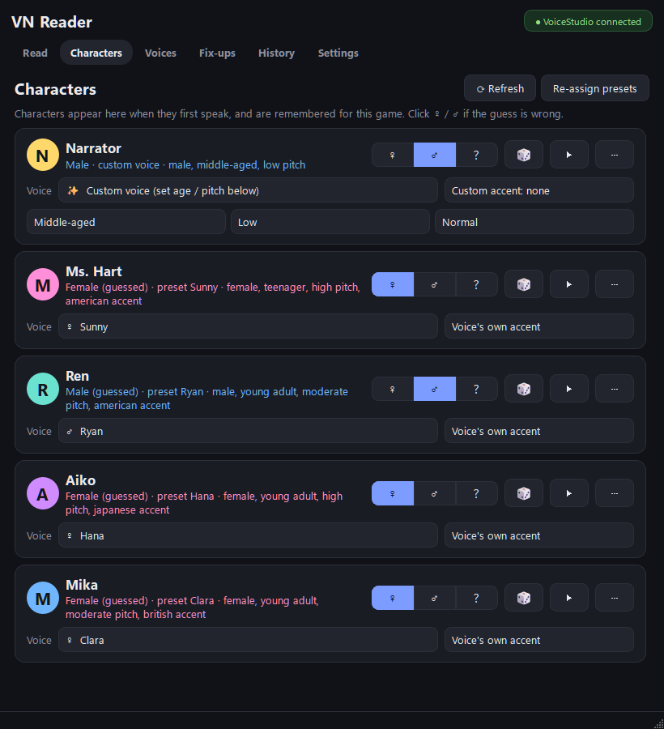

<p align="center">
  
</p>

<h1 align="center">VNR: VN Reader</h1>

<p align="center">
  <b>Turns any visual novel into a fully voiced one.</b><br>
  It reads the dialogue off your screen and speaks it with a different, natural AI voice
  for every character: male voices for male characters, female voices for female ones.
</p>

<p align="center">
  
</p>

---

## Contents
- [What it does](#what-it-does)
- [Requirements](#requirements)
- [Installation](#installation)
  - [Option A: download the ready-made .exe](#option-a-download-the-ready-made-exe-easiest)
  - [Option B: run from source](#option-b-run-from-source)
  - [Set up VoiceStudio (natural voices)](#set-up-voicestudio-natural-voices)
- [First start, step by step](#first-start-step-by-step)
- [Using the app](#using-the-app)
- [Hotkeys](#hotkeys)
- [Settings reference](#settings-reference)
- [Tips & troubleshooting](#tips--troubleshooting)
- [FAQ](#faq)
- [For developers](#for-developers)

---

## What it does

| | |
|---|---|
| 🖥️ **Works with any visual novel** | Ren'Py, KiriKiri, Unity, anything. It reads the text from the screen (OCR), so it never touches the game's files. |
| 🗣️ **A voice per character** | Character names are read from the top line of the dialogue box. Each new character automatically gets their own voice, matched to their gender. |
| 🎙️ **11 ready-made voice presets** | 8 female and 3 male, all editable: age, pitch, accent, style. Add your own as well. |
| 🔒 **Voices that never drift** | Each voice is made once, checked for quality, and saved in VoiceStudio, so a character sounds the same on every line. |
| 😆 **Emotions** | Laughs, sighs and surprise ("Ahaha", "*sigh*", "Eh?!") are performed, not read out as words. |
| 🔞 **Made for adult VNs too** | Moans, drawn-out sounds, stutters, honorifics and explicit words are read exactly as written, never "corrected" or dropped. |
| ⏭️ **Auto-advance** | After a line has been read, the app moves the game on to the next one, so you can listen hands-free like an audiobook. |
| 🧹 **Clean text** | Skips menu buttons (Back / Skip / Auto / Save…), drops garbled OCR junk, and fixes common misreads. |
| 🕘 **Remembers every game** | Pick a game you've played before and its window, reading area, characters and voices all come back. |
| ⌨️ **Global hotkeys** | Start, pause, replay and auto-advance from inside the game. |
| 💾 **Runs locally** | Text recognition uses Windows' built-in OCR, and voices come from VoiceStudio on your own PC. Nothing is sent to the internet. |

---

## Requirements

| | Needed? | Notes |
|---|---|---|
| **Windows 10 or 11** (64-bit) | ✅ required | It uses Windows' built-in text recognition and window capture. |
| **[VoiceStudio](https://github.com/debpalash/voicestudio)** | ⭐ strongly recommended | The free, local AI voice app that makes the natural per-character voices. Without it, VN Reader falls back to the robotic built-in Windows voices. |
| **NVIDIA GPU** | 👍 recommended | VoiceStudio also runs on the CPU, but much slower. On an RTX 3060 Ti a line takes about 1–2 s. |
| **Python 3.11–3.13** | only for Option B | Not needed for the .exe. |

---

## Installation

### Option A: download the ready-made .exe (easiest)

1. Go to the **[Releases](../../releases)** page and download **`VN.Reader.exe`** from the latest release.
2. Put it anywhere you like, e.g. `C:\Games\VN Reader\`.
3. Double-click it. That's it: no installer, no Python.
   > Windows SmartScreen may warn you because the exe isn't code-signed. Click **More info → Run anyway**.

Your settings are saved in `%APPDATA%\VNReader\settings.json`, so you can move or replace the exe without losing anything.

### Option B: run from source

1. Install **Python 3.13** from [python.org](https://www.python.org/downloads/). During setup, tick **"Add Python to PATH"**.
2. Download this repository: **Code → Download ZIP** and extract it, or:
   ```bash
   git clone https://github.com/mdsamiulhaq03/VNR.git
   cd VNR
   ```
3. Double-click **`VN Reader.bat`**.
   The first run creates a virtual environment (`.venv`) and installs everything from `requirements.txt` automatically. That takes a few minutes; after that it starts straight away.

<details>
<summary>Manual setup (if you prefer the command line)</summary>

```bash
py -3.13 -m venv .venv
.venv\Scripts\python -m pip install -r requirements.txt
.venv\Scripts\python main.py
```
</details>

### Set up VoiceStudio (natural voices)

1. Install VoiceStudio from **https://github.com/debpalash/voicestudio**. In PowerShell:
   ```powershell
   irm https://voicestudio.sh/install.ps1 | iex
   ```
   or download the Windows installer from its releases page.
2. Start VoiceStudio and let it download its voice model the first time.
3. Keep VoiceStudio running while you play.

VN Reader finds it automatically at `http://127.0.0.1:3900`. The top-right badge turns green: **● VoiceStudio connected**. If you run it on another PC or port, change the address in **Settings → Voices**.

> You don't need to create any voices in VoiceStudio yourself. VN Reader makes them for you and saves them in your VoiceStudio library as `VNR - <voice name>`.

---

## First start, step by step

1. **Start your visual novel**, preferably in **windowed** or **borderless** mode (see [tips](#tips--troubleshooting)).
2. **Start VoiceStudio** and then **VN Reader**.
3. On the **Read** tab, click **⚙ Setup**:
   1. **Window**: pick your game from the list. The reading area then follows the game window, even if you move or resize it.
   2. **Profile**: the name your characters and voices are saved under. It's filled in from the game automatically.
   3. Click **✏ Draw reading area** and drag **one box around the whole dialogue box, including the character name on its top line.**
4. Click **▶ Start reading** (or press **F9**).
5. Play. Every new line is read aloud as soon as it has finished appearing. Clicking ahead in the game cuts off the current line.

New characters appear in the **Cast** list automatically, each with their own voice. The very first line of a new voice takes about 10–20 seconds extra while VoiceStudio prepares it. After that, lines start in about 1–2 seconds.

---

## Using the app

### Read tab (dashboard)

| Part | What it does |
|---|---|
| **Header** | The game name and stats. Use the **dropdown** to switch to another game you've played, **🗑** to delete this game from your history, and **⚙ Setup** to change the window, profile, language or reading area. |
| **Auto-advance** | When a line has been read, the app moves the game to the next line for you. **F7** switches it on and off. |
| **Read names aloud** | Off by default, so only the dialogue is spoken. Turn it on to hear "Aiko." before each of her lines. |
| **Now speaking** | Who's talking, which voice they use, and a level meter, plus pause ⏸, stop ⏹, replay ↺, mute 🔊, volume and speed. |
| **Live area** | A live view of what the app is reading. The **name line is outlined in pink** and the **dialogue in blue**, so you can see at a glance whether the area is right. |
| **Cast** | Every character in this game. Search, sort, ▶ preview a voice, and **⋯** to edit, **merge** or **delete** a character. |

> **Who is speaking?** If the dialogue box has a name on its top line, that character speaks. **No name means the narrator**, and the narrator reads the whole text.

### Characters tab


Each character has a card:
- **♀ / ♂ / ?**: the gender is guessed from the name (English and Japanese names, plus titles like *Mr.*, *Ms.*, *Onee-chan*, *-kun*). If a guess is wrong, click to fix it and the character gets a voice of the right gender.
- **Voice**: any **preset**, a **custom voice** (choose age, pitch and style yourself), one of **your own VoiceStudio voices**, or a **Windows voice**.
- **Accent**: change this character's accent only.
- **🎲**: switch to the next free preset. **▶**: preview.
- **⋯**: merge or delete.

**Merging duplicates:** when the text reader misreads a name (for example "Sayorl" instead of "Sayori"), a second character appears. Use **⋯ → Merge into → Sayori**. The lines are combined, and the misspelling is remembered so it never comes back.

<br clear="right">

### Voices tab (presets)


The 11 built-in voices:

| ♀ Female | | ♂ Male | |
|---|---|---|---|
| **Sunny** | bright, energetic teenager | **Ryan** | young man, protagonist / friend |
| **Hana** | anime-style heroine, Japanese accent | **Kai** | boyish teenager |
| **Clara** | polite and clear, British | **James** | mature, British: teacher / father |
| **Mia** | friendly, casual | | |
| **Rose** | cool, low voice | | |
| **Elena** | elegant older woman, British | | |
| **Lily** | little girl | | |
| **Yuki** | shy teenager, British | | |

Change any preset's **name, ♀/♂, age, pitch, accent and style** (Normal or Whisper). **🎲** gives a different person with the same settings, **⧉** duplicates a preset, **+ ♀ / + ♂ voice** adds a new one, and **Reset** restores the built-in set.

New characters automatically get an **unused preset of their gender**, so the first 8 female characters all sound different. After that, extra characters get a custom voice with its own pitch and accent.

<br clear="right">

### Fix-ups tab
Your own word replacements, applied before a line is spoken. Use them for names the voice pronounces wrong (`Saeko` → `Sah-eh-ko`) or recurring OCR mistakes. You can make a rule for **this game** or **all games**. Rules also apply to character names.

### History tab
Every line read this session, with the speaker. **Double-click** a line to hear it again. **Copy** or **Export…** saves it to a text file.

### Settings tab


See the [settings reference](#settings-reference) below for every option.

<br clear="right">

---

## Hotkeys

These work **while you're in the game**. You can change them in Settings.

| Key | Action |
|---|---|
| **F9** | Start / stop reading |
| **F10** | Replay the last line |
| **F11** | Pause / resume |
| **F8** | Stop speaking |
| **F7** | Auto-advance on / off |

---

## Settings reference

<details open>
<summary><b>Text recognition</b></summary>

| Setting | What it does |
|---|---|
| **Image cleanup** | *Auto* (recommended) cleans up the image before reading it. *Text colour only* keeps only pixels of one colour: best for animated or see-through text boxes. *Off* reads the raw image. |
| **Pick text colour…** | Click a letter of the dialogue to choose its colour (for *Text colour only*). **Colour tolerance** sets how strict that colour match is. |
| **Name on top line** | *Auto-detect* (recommended), *Always* (the top line is always a name) or *Never* (this game has no names). |
| **Test OCR on the reading area** | Shows exactly what the app sees: the cleaned-up image, the name, the text, what was skipped and why, and what was fixed. |
</details>

<details open>
<summary><b>Voices</b></summary>

| Setting | What it does |
|---|---|
| **VoiceStudio address / API key** | Normally `http://127.0.0.1:3900` with no key. You only need a key for a VoiceStudio on another PC. |
| **Read lines with no speaker name** | Read narration (on) or skip it (off). |
| **Read speaker names aloud** | Speak "Name." before each line. Off by default. |
| **Expressive voices** | Laughs, sighs, surprise and annoyed sounds (VoiceStudio). |
| **Voice quality** | *Fast* (starts talking quickest), *Balanced* (recommended), *Best* (slowest). |
| **Save each character's voice** | Keeps every voice identical on every line. Leave it on: without it, VoiceStudio re-invents the voice for every sentence. |
| **Accent for all voices** | One accent for everyone (e.g. British), or keep each voice's own. |
</details>

<details open>
<summary><b>Auto-advance</b></summary>

| Setting | What it does |
|---|---|
| **Next line by** | *Press Enter* works in most games (Ren'Py included). Use *Click the dialogue box* if your game ignores keys. *Space* and *Ctrl* are also available. |
| **Pause after each line** | How long to wait after the voice finishes (0–4 s). |

Auto-advance stops by itself at choice menus, because the text stops changing.
</details>

<details open>
<summary><b>Text clean-up</b></summary>

| Setting | What it does |
|---|---|
| **Ignore menu words** | Lines made of these words are treated as menu buttons and skipped. Defaults: Back, History, Skip, Auto, Save, Load, Q.Save, Q.Load, Prefs, Settings, Menu… |
| **Fix common OCR mistakes** | English only: `rn`→`m`, `\|`→`I`, `Tbe`→`The`. Character names, interjections and adult vocabulary are never changed. |
</details>

<details>
<summary><b>Hotkeys & everything else</b></summary>

Change or clear any hotkey. Everything is saved automatically in `%APPDATA%\VNReader\settings.json`.
</details>

---

## Tips & troubleshooting

| Problem | Fix |
|---|---|
| **Nothing is read** | Check **Setup**: is the right game window picked, and is the reading area drawn? Click **👁 Show** to see where the area is, and **Settings → Test OCR** to see what's being read. |
| **The game is full-screen and the area is wrong / black** | Use **windowed** or **borderless window** mode. True exclusive full-screen can block screen capture. |
| **It stops reading when another window covers the game** | Tick **Setup → Keep reading when the game is covered**. Some games block this; the app tells you if yours does. |
| **Garbage or menu words get read** | Draw the area tightly around the text box only. Add the extra words to **Settings → Ignore menu words**. |
| **Lines with animated or see-through backgrounds aren't read** | Set **Image cleanup → Text colour only**, then click **Pick text colour…** and click on a letter. |
| **A name is read as part of the dialogue (or vice versa)** | Set **Settings → Name on top line** to *Always* or *Never* for that game. |
| **A name is misread and a duplicate character appears** | Use **⋯ → Merge into** on the duplicate. |
| **Wrong gender** | Click ♀ / ♂ on the character's card. |
| **A voice is pronounced wrong** | Add a rule on the **Fix-ups** tab. |
| **"VoiceStudio offline"** | Start VoiceStudio and wait until its model has loaded. Until then, Windows voices are used. |
| **The first line of a new character is slow** | That's normal: the voice is being prepared once (10–20 s). After that it's fast. |
| **Lines start too slowly** | **Settings → Voice quality → Fast**. |
| **Auto-advance doesn't move the game on** | Switch **Next line by** to *Click the dialogue box*, and make sure the game window is picked in Setup. |
| **A hotkey shows "already used by another app"** | Another program (or a second copy of VN Reader) uses that key. Pick a different key in Settings. |
| **Non-English games** | Set **Language** in Setup (e.g. `ja`, `zh-Hans`), and install that language's OCR pack: *Windows Settings → Time & language → Language & region → Add a language*. Spelling fixes are English-only. |

---

## FAQ

**Does it modify my games?**
No. It only looks at the screen. Nothing in the game folder is touched.

**Does anything go to the internet?**
No. Text recognition is built into Windows, and the voices are made by VoiceStudio on your own PC.

**Can I use it without VoiceStudio?**
Yes, with the built-in Windows voices. Characters still get gender-matched voices with different pitches, but they sound robotic.

**Can I use my own voice or a cloned voice?**
Yes. Create a voice in VoiceStudio, click **⟳ Refresh** on the Characters tab, then choose it under **Voice → My VoiceStudio voices**.

**What are the `VNR - …` voices in my VoiceStudio library?**
These are the stable voices VN Reader made for your presets and characters. Deleting a game or character removes the ones nothing uses any more. You can also delete them in VoiceStudio; they're recreated when needed.

**Where are my settings?**
In `%APPDATA%\VNReader\settings.json`. Delete that file to start fresh.

---

## For developers

### Project layout
```
main.py                     entry point (also: main.py --selftest out.txt)
app/
  config.py                 settings, per-game characters, delete / merge
  voices.py                 gender guessing, presets → voice designs
  presets.py                the built-in 3 male / 8 female presets
  voice_bank.py             one stable (cloned) VoiceStudio voice per design, with quality checks
  speech_queue.py           sentence-by-sentence synthesis, interruption, auto-advance signal
  emotion.py                [laughter] / [sigh] / surprise tags
  name_split.py             speaker name vs. dialogue (no name → narrator)
  audio_qa.py               rejects whispery / squeaky reference clips
  sources/
    capture.py              screen / window capture (follows the game window)
    ocr_source.py           Windows OCR, live preview, name-box re-reading
    ocr_filter.py           menu / junk filtering, OCR spell-fixes
    preprocess.py           image clean-up for OCR
  tts/                      VoiceStudio and Windows (SAPI) engines
  audio/player.py           gapless audio playback
  ui/                       PySide6 interface (dashboard, characters, voices, settings…)
  hotkeys.py, winapi.py     global hotkeys, window capture, auto-advance input
tests/                      pytest suite
tools/make_icon.py          regenerates assets/vnr.ico
```

### Run the tests
```bash
.venv\Scripts\python -m pip install -r requirements-dev.txt
.venv\Scripts\python -m pytest -q
```

### Build the .exe
```bash
build_exe.bat
```
This produces `dist\VN Reader.exe`: one file built with PyInstaller (`vn_reader.spec`), with the VNR icon. Check it with:
```bash
"dist\VN Reader.exe" --selftest result.txt
```

### Built with
[PySide6](https://doc.qt.io/qtforpython/) · [VoiceStudio](https://github.com/debpalash/voicestudio) (OmniVoice) · Windows.Media.Ocr via [winocr](https://pypi.org/project/winocr/) · [mss](https://pypi.org/project/mss/) · [sounddevice](https://pypi.org/project/sounddevice/) · [pyspellchecker](https://pypi.org/project/pyspellchecker/) · [gender-guesser](https://pypi.org/project/gender-guesser/) · [PyInstaller](https://pyinstaller.org/)

VoiceStudio is a separate project with its own license (AGPL-3.0). VN Reader only talks to it over its local API and doesn't include any of its code.
